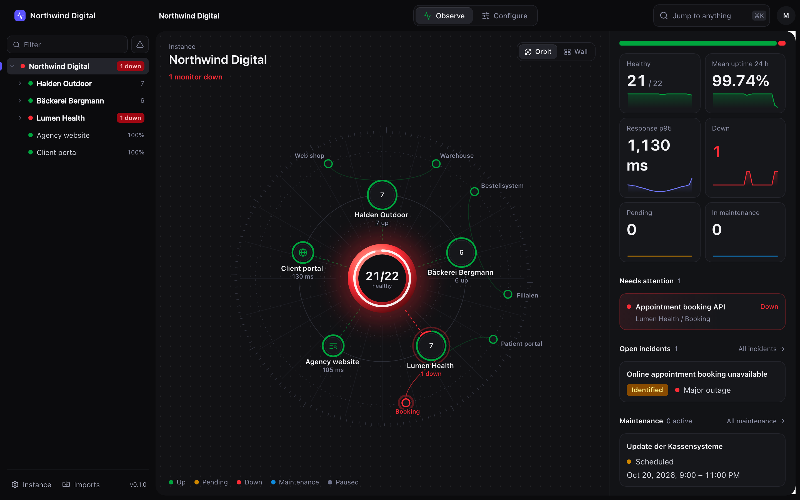
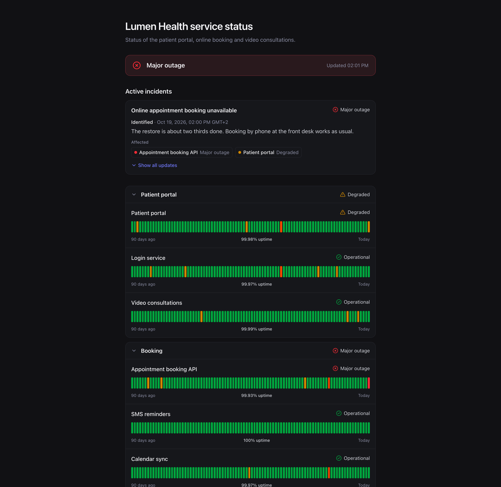
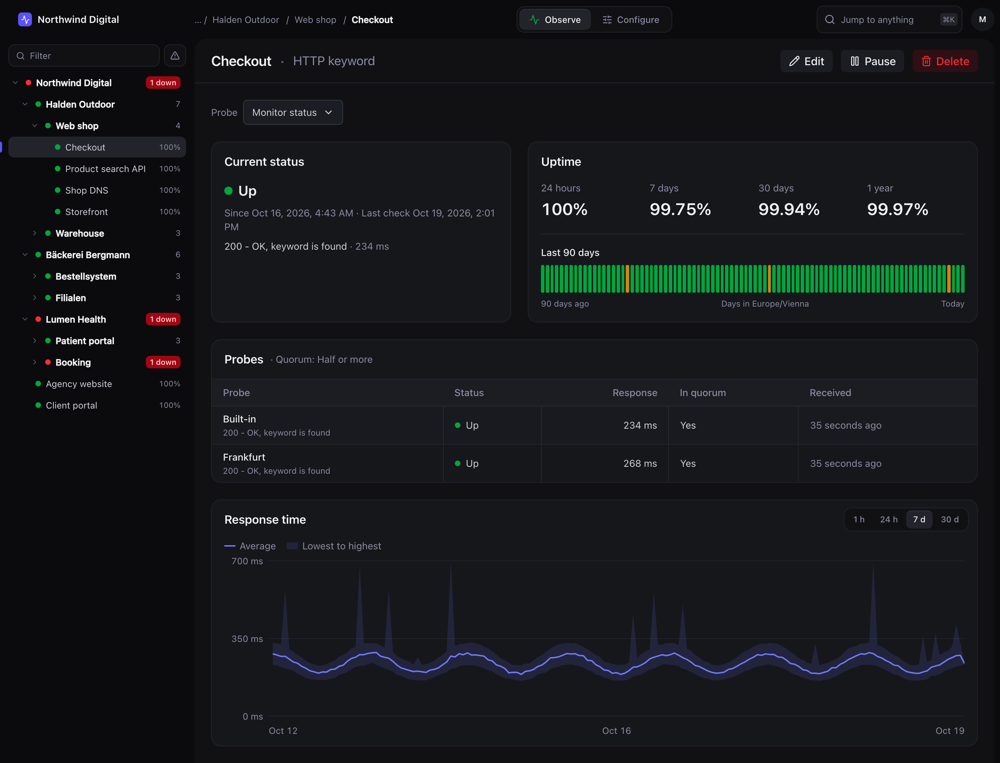
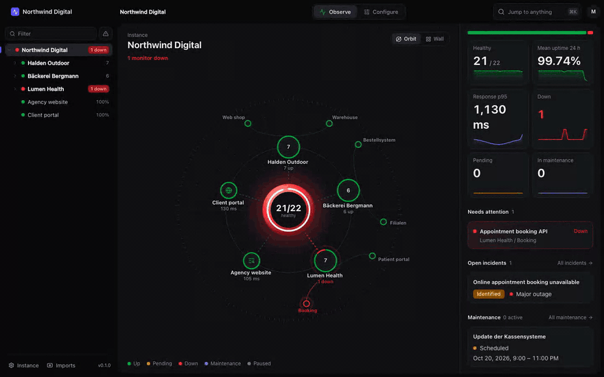

<div align="center">

# V1Per

**Uptime monitoring and status pages for every client you look after.**

One self-hosted instance for your agency, your clients and their teams. Monitors, status pages, incidents and remote probes, in one Rust binary. Imports your Uptime Kuma data.

[](LICENSE)
[](CHANGELOG.md)
[](https://github.com/coderscantina/v1per/actions/workflows/ci.yml)
[](https://github.com/coderscantina/v1per/releases)

[Quickstart](#quickstart) · [Guide](docs/guide/README.md) · [Comparison](#how-it-compares) · [Changelog](CHANGELOG.md)



</div>

> [!NOTE]
> V1Per is in beta. Every feature below is built, and you should still expect rough edges. Releases use calendar versions, e.g. `v26.10.19-010a9a6`.

## Why V1Per

- **One instance, many clients.** Nodes form a tree of any depth: your agency, each client, their teams. Invite people at any node and they see that subtree, nothing else.
- **Status pages and incidents in the same place.** Every client gets its own pages on its own domain, with an incident timeline and scheduled maintenance. Customers read updates there instead of asking you.
- **Small to run.** One process, one data directory, SQLite and an embedded DuckDB. No Postgres, no Redis, no queue to look after.

## Features

- **Node tree and access.** Nested nodes, invitations, owner, admin, member and viewer roles, and a two-factor requirement per node.
- **Monitors.** HTTP, keyword, JSON query, TCP port, ping, DNS, push, group, manual and TLS certificate expiry.
- **Probes.** A built-in probe, plus remote agents (`v1per-probe`, a static binary of a few MB) that only make outbound HTTPS calls. A majority of probes decides whether a monitor is down.
- **Status pages.** Public, sign-in, password, magic link or share token access. Custom domains, 90-day uptime bars, live updates, badges, logos, English and German.
- **Incidents and maintenance.** Manual incidents with updates and per-component impact, incidents that monitors open on their own, and one-off or recurring maintenance windows.
- **Notifications.** Email (SMTP), Slack, Discord, Microsoft Teams, Telegram, ntfy, Pushover and webhooks, with a test button and a delivery log.
- **Accounts.** TOTP two-factor sign-in with recovery codes, API keys, and secrets encrypted at rest.
- **Uptime Kuma import.** A one-shot import from Kuma 2.5.0, heartbeat history included, with a dry run. Existing push URLs (`/api/push/:token`) keep working.
- **Operations.** `backup`, `restore`, `upgrade`, `retention` and `diagnostics` commands, a `/health` endpoint, and a Docker image for amd64 and arm64.

<table>
  <tr>
    <td width="50%">
      
    </td>
    <td width="50%">
      
    </td>
  </tr>
</table>



## Quickstart

You need Docker and a domain pointing at your server. The compose file binds to `127.0.0.1:8080`, so put a reverse proxy with TLS in front of it ([Caddy example](deploy/Caddyfile)).

```bash
curl -O https://raw.githubusercontent.com/coderscantina/v1per/main/deploy/docker-compose.yml
export V1PER_PUBLIC_URL=https://status.example.com
docker compose run --rm v1per init --admin-email you@example.com   # prints the admin password once
docker compose up -d
```

Open your public URL and sign in. Then create a node for your first client and add a monitor.

Moving from Uptime Kuma? Stop Kuma, create an empty node for the import, and run a dry run first:

```bash
docker compose run --rm -v ./kuma.db:/kuma.db:ro v1per import kuma --source /kuma.db --into Root/Clients/Acme --dry-run
```

The [guide](docs/guide/README.md) covers [installation](docs/guide/install.md), [configuration](docs/guide/configuration.md), [the Kuma migration](docs/guide/kuma-migration.md), [probes](docs/guide/probes.md), [status pages](docs/guide/status-pages.md), [notifications](docs/guide/notifications.md) and [operations](docs/guide/operations.md).

## How it compares

V1Per is built for monitoring many clients from one instance. Here's where it stands next to the tools people usually run, as of October 2026, for their self-hosted editions.

|                                     | V1Per                         | Uptime Kuma          | OpenStatus                  | Gatus                  |
| ----------------------------------- | ----------------------------- | -------------------- | --------------------------- | ---------------------- |
| Many clients in one instance        | Nested node tree              | No                   | Workspaces                  | No                     |
| Users and roles                     | Invites and roles per node    | One admin            | Invites and roles           | No                     |
| Status pages                        | Many, custom domains          | Many, custom domains | Many, custom domains        | One built-in page      |
| Private status pages                | Sign-in, password, magic link, share token | No      | Password, email domain      | Whole instance only    |
| Incident timeline                   | Yes                           | Pinned post          | Yes                         | Announcements          |
| Scheduled maintenance               | Yes                           | Yes                  | Yes                         | Alert suppression only |
| Self-hosted remote probes           | Yes, majority quorum          | No                   | Private locations, quorum   | No                     |
| Two-factor sign-in                  | TOTP                          | TOTP                 | Through your OIDC provider  | No                     |
| Uptime Kuma import                  | Yes, with history             | n/a                  | No                          | No                     |
| Monitor types                       | 10                            | 25+                  | 7                           | 12+                    |
| Notification channels               | 8                             | 90+                  | About 14                    | 40+                    |
| What you run                        | One binary, embedded storage  | One Node.js process  | About 8 services            | One binary             |
| Configuration                       | Web app and API               | Web app              | Web app, YAML, Terraform    | YAML                   |
| License                             | AGPL-3.0                      | MIT                  | AGPL-3.0                    | Apache-2.0             |

Pick Uptime Kuma if you need its long list of monitor types and notification channels. Pick Gatus if you want monitoring as code in YAML. Pick V1Per if you look after many clients and want their monitors, status pages and incidents in one place.

## Tech stack

- **Server:** Rust with Axum, SQLite through SQLx, embedded DuckDB for heartbeat history
- **Web app:** Vue 3, Vite and Tailwind 4, built with Bun, served by the same binary
- **API:** typed end to end, with an OpenAPI description in [`crates/protocol/openapi.json`](crates/protocol/openapi.json)

## Contributing

Bug reports and pull requests are welcome. Start with the [contributing guide](CONTRIBUTING.md). It covers the dev setup, the gitmoji commit format and the checks CI runs.

- [GitHub Discussions](https://github.com/coderscantina/v1per/discussions) for questions and ideas
- [GitHub Issues](https://github.com/coderscantina/v1per/issues/new/choose) for bugs and feature requests

Please report vulnerabilities privately, as described in the [security policy](SECURITY.md).

## License

V1Per is licensed under the [GNU AGPLv3](LICENSE).

## Acknowledgements

- Louis Lam and contributors for [Uptime Kuma](https://github.com/louislam/uptime-kuma), which V1Per replaces and imports from
- The [OpenStatus](https://www.openstatus.dev/) team for the status page ideas
- The people behind the Rust and Vue libraries V1Per is built on
